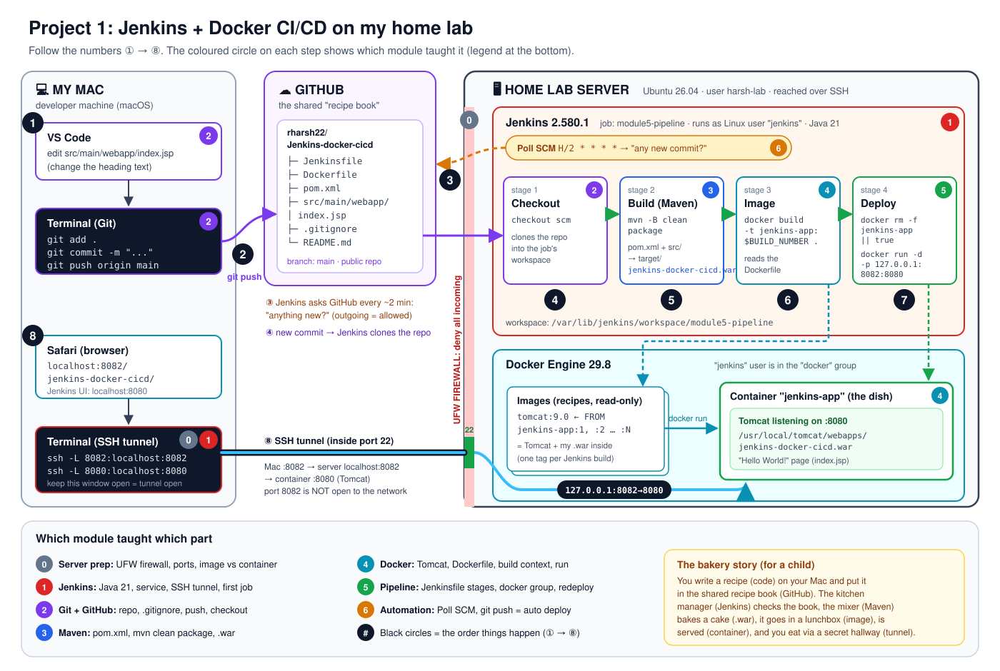
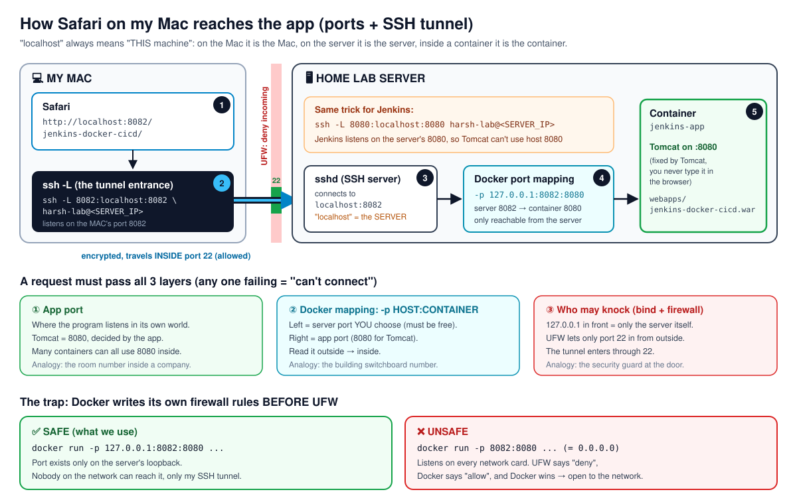
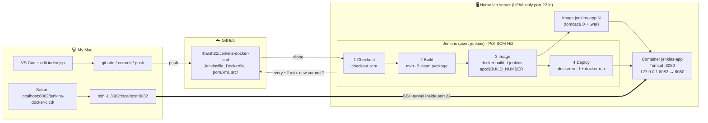

# Project 1 Wrap-Up: Jenkins + Docker CI/CD on my home lab

> **What this file is:** a full recap of my first DevOps project, written so that in 2–3 months I can read it once and remember everything: what I built, why each piece exists, every question I asked along the way, and the answers in simple words.
>
> **Source:** all my chats about this project (Oct 7 → Oct 23, 2026), read end to end.
> **Repo:** https://github.com/rharsh22/Jenkins-docker-cicd
> **Based on:** project #05 of https://github.com/NotHarshhaa/DevOps-Projects (my Project 1 = their #05).

---

## Contents

1. [The project in 60 seconds](#1-the-project-in-60-seconds)
2. [The finished setup (facts and final files)](#2-the-finished-setup-facts-and-final-files)
3. [The journey, module by module](#3-the-journey-module-by-module)
4. [Concept dictionary (with analogies)](#4-concept-dictionary-with-analogies)
5. [Every question I asked, with answers](#5-every-question-i-asked-with-answers)
6. [Errors I hit (troubleshooting log)](#6-errors-i-hit-troubleshooting-log)
7. [Things Claude got wrong (so I don't learn them wrong)](#7-things-claude-got-wrong-so-i-dont-learn-them-wrong)
8. [Cheat sheet: commands I used](#8-cheat-sheet-commands-i-used)
9. [Interview questions with model answers](#9-interview-questions-with-model-answers)
10. [Golden rules (memorise these)](#10-golden-rules-memorise-these)
11. [What is still left to do](#11-what-is-still-left-to-do)
12. [Bridge to Project 2 (Kubernetes on k3s)](#12-bridge-to-project-2-kubernetes-on-k3s)
13. [Appendix: timeline and text-only diagram](#13-appendix-timeline-and-text-only-diagram)

---

## 1. The project in 60 seconds

**What I built:** a robot that ships my web app by itself. I edit one file on my Mac and `git push`. Within about 2 minutes, Jenkins on my home server notices the new commit, pulls the code, builds it with Maven into a `.war` file, packs it into a Docker image with Tomcat, replaces the old container with a new one, and the new page shows up in my browser. I never click anything.



**The flow in one line:**

```
Mac (edit + git push) → GitHub → Jenkins polls → Checkout → Maven (.war) → docker build (image) → docker run (container) → Safari via SSH tunnel
```

### The bakery story (explain it to a child)

| Real thing | Bakery |
|---|---|
| My code (`index.jsp`, `pom.xml`) | A **recipe** I write at home |
| GitHub | The shared **recipe book** everyone can read |
| Jenkins | The **kitchen manager** who checks the book every 2 minutes for new recipes |
| Maven | The **mixer** that turns the recipe into a baked cake |
| `.war` file | The **cake** |
| Dockerfile | Instructions for **packing the cake into a lunchbox** |
| Docker image | The **packed lunchbox** (sealed, never changes) |
| Container | The lunchbox **opened and served** on the table |
| Tomcat | The **plate/oven** that serves Java cakes |
| UFW firewall | The **security guard**: only the front door (port 22) opens |
| SSH tunnel | A **private hallway** from my house into the kitchen, through the front door |

### How the request reaches the app (ports)



---

## 2. The finished setup (facts and final files)

### My environment

| Thing | Value |
|---|---|
| Mac | Developer machine: VS Code, Terminal, Safari, Termius. Has Git, Java and Maven. SSH key `~/.ssh/id_rsa`. |
| Home server | Ubuntu 26.04 LTS, i5-9300H, 22 GB RAM, 466 GB disk, user `harsh-lab`, host `harshdevops-lab` |
| Firewall | UFW active: deny incoming, allow outgoing, only OpenSSH (22) allowed |
| Java | OpenJDK 21 (17 still installed); `update-alternatives` in **auto mode** |
| Jenkins | 2.580.1 (LTS), runs as Linux user `jenkins`, web UI on server port 8080 |
| Jenkins Maven tool | `maven-3` (auto-installed by Jenkins, Apache Maven 3.10.0) via the **Maven Integration** plugin |
| Docker | 29.8.1; `jenkins` user added to the `docker` group |
| Git on server | 2.53.0 |
| App | Maven web-app archetype: `pom.xml`, `src/main/webapp/index.jsp`, `WEB-INF/web.xml` |
| Build output | `target/jenkins-docker-cicd.war` (no version in the name, because the pom has `<finalName>`) |
| Image | `jenkins-app:<BUILD_NUMBER>` (e.g. `jenkins-app:5`) |
| Container | `jenkins-app`, published as `127.0.0.1:8082 → 8080` |
| App URL (through the tunnel) | `http://localhost:8082/jenkins-docker-cicd/` |
| Jenkins URL (through the tunnel) | `http://localhost:8080` |

### Jenkins jobs I made

| Job | Type | What it taught |
|---|---|---|
| `module1-hello` | Freestyle | `whoami` → `jenkins`, `pwd` → `/var/lib/jenkins/workspace/module1-hello`, `docker ps` → permission denied |
| `module2-checkout` | Freestyle | Jenkins clones the GitHub repo into its workspace (`ls -al`) |
| `module3-maven-build` | Freestyle | Jenkins runs `mvn clean package` → `.war` in `target/` |
| `module5-pipeline` | **Pipeline** (script from SCM) | The real thing: Jenkinsfile with 4 stages + Poll SCM trigger |

### Final Dockerfile (in the repo root)

```dockerfile
FROM tomcat:9.0
COPY target/jenkins-docker-cicd.war /usr/local/tomcat/webapps/
EXPOSE 8080
```

| Line | Meaning |
|---|---|
| `FROM tomcat:9.0` | Start from the official Tomcat image (it already has Linux + Java + Tomcat) |
| `COPY target/...war /usr/local/tomcat/webapps/` | Take the `.war` from the **build context** (the Jenkins workspace) and put it in Tomcat's "disc tray" inside the image |
| `EXPOSE 8080` | A **label** saying the app listens on 8080. It does **not** open any port. `-p` does that. |

No `CMD` is needed: the Tomcat base image already starts Tomcat (`catalina.sh run`).

### Final Jenkinsfile (in the repo root)

```groovy
pipeline {
    agent any
    triggers { pollSCM('H/2 * * * *') }
    tools { maven 'maven-3' }
    options { skipDefaultCheckout(true) }
    stages {
        stage('Checkout') {
            steps { checkout scm }
        }
        stage('Build') {
            steps { sh 'mvn -B clean package' }
        }
        stage('Image') {
            steps { sh 'docker build -t jenkins-app:$BUILD_NUMBER .' }
        }
        stage('Deploy') {
            steps {
                sh 'docker rm -f jenkins-app || true'
                sh 'docker run -d --name jenkins-app -p 127.0.0.1:8082:8080 jenkins-app:$BUILD_NUMBER'
            }
        }
    }
}
```

| Piece | Why it's there |
|---|---|
| `agent any` | Run on any available Jenkins machine (I only have one) |
| `triggers { pollSCM('H/2 * * * *') }` | **When** to run: check GitHub about every 2 minutes, build only if there's a new commit |
| `tools { maven 'maven-3' }` | Put the Maven I set up in Module 3 on the PATH |
| `options { skipDefaultCheckout(true) }` | Stop Jenkins from cloning twice (I clone explicitly in the Checkout stage) |
| `checkout scm` | Clone the same repo the Jenkinsfile came from |
| `mvn -B clean package` | `-B` = batch mode (clean logs). Builds the `.war`. |
| `docker build -t jenkins-app:$BUILD_NUMBER .` | Build an image tagged with the Jenkins build number. `.` = the workspace is the build context. |
| `docker rm -f jenkins-app \|\| true` | Remove the old container to free the **name** and **port 8082**. `\|\| true` = "if this fails, carry on". |
| `docker run -d ... -p 127.0.0.1:8082:8080 ...` | Start the new container, reachable only from the server itself |

`triggers` is about **when**; everything inside `stages { }` is about **what**.

---

## 3. The journey, module by module

```
GitHub → [Jenkins] → Maven → Docker → (joined in a pipeline) → (triggered automatically)
```

Every module followed the same loop: **map → concept → I do it → verify → explain it back.**

| # | Module | Status |
|---|---|---|
| 0 | Server prep | ✅ |
| 1 | Jenkins | ✅ |
| 2 | Git + GitHub | ✅ |
| 3 | Maven | ✅ |
| 4 | Docker image for the app | ✅ |
| 5 | Jenkins pipeline (Jenkinsfile) | ✅ |
| 6 | Automation trigger (Poll SCM) | ✅ |
| 7 | Wrap-up (README, troubleshooting log, summary, screenshots) | ⏳ in progress |

### Module 0: Server prep

**Map:** the foundation under everything. **Problem it solves:** a server with every door unlocked.

| Step | What I did | Why |
|---|---|---|
| 0.1 | Checked the server: `lsb_release -a`, `free -h`, `df -h`, `docker --version`, `java --version`, `sudo ufw status` | Know what I have before installing anything |
| 0.2 | Turned on UFW: `default deny incoming` → `default allow outgoing` → `allow OpenSSH` → `enable` → `status verbose` | Close every door except SSH. **Allow SSH before enabling**, or I lock myself out. |
| 0.3 | Learned ports, `-p OUTSIDE:INSIDE`, and SSH tunnels (`-L`) | Needed for Jenkins and the app later |
| 0.4 | SSH key check: Mac has `id_rsa`, server has `authorized_keys`, `passwordauthentication yes`; key-only login tested OK with `ssh -o PasswordAuthentication=no ...` | Prove the key works before ever turning passwords off |
| — | **Deferred:** switching SSH to key-only, because Termius still logs in with a password | Optional, do later |

**Golden rules:** *Close everything, open only what you need, and check that it worked.* · *Allow SSH first, then enable.* · *Prove the key works first, then remove the password.*

### Module 1: Jenkins

**Map:** `GitHub → [Jenkins] → Maven → Docker`. **Problem it solves:** manual builds are slow and inconsistent; Jenkins runs the same steps every time.

| Step | What | Result |
|---|---|---|
| 1.1 | Java 21 | Current Jenkins LTS (2.555+) needs Java 21 or 25. Java 21 was already installed but `java` pointed at 17 (manual mode). `sudo update-alternatives --config java` → chose **0 (auto mode)** → Java 21 ✅ |
| 1.2 | Jenkins installed + running | 2.580.1 was already installed. `sudo systemctl restart jenkins` → `active (running)` ✅ |
| 1.3 | SSH tunnel from the Mac | `ssh -L 8080:localhost:8080 harsh-lab@<SERVER_IP>` (run **on the Mac**) → `http://localhost:8080` works ✅ |
| 1.4–1.5 | Unlock + setup wizard | Already done in earlier practice (auto-login as `admin`) ✅ |
| 1.6 | Health check | No warnings; updated 2 library plugins (ASM API, Jackson 3 API) ✅ |
| 1.7 | Hello job | `whoami` = `jenkins`, workspace = `/var/lib/jenkins/workspace/module1-hello`, `docker ps` = **permission denied** (fixed in 5.2) ✅ |

**Golden rules:** *"Installed" doesn't mean "in use".* · *`ssh -L` always runs on the machine where your browser is.* · *Jenkins is a separate user in its own folder: when something works for you but fails in Jenkins, check who and where first.*

### Module 2: Git + GitHub

**Map:** `You → [GitHub] → Jenkins`. **Problem it solves:** the code needs a home that Jenkins can reach.

| Step | What | Result |
|---|---|---|
| 2.1 | Public repo `Jenkins-docker-cicd` with README, **Maven** `.gitignore`, MIT licence | ✅ |
| 2.2 | Generated the app on the Mac: `mvn archetype:generate -DgroupId=com.example -DartifactId=jenkins-docker-cicd -DarchetypeArtifactId=maven-archetype-webapp -DinteractiveMode=false` (on the Desktop, **outside** the repo), copied `pom.xml` + `src` into the clone, then `git status` → `add` → `commit` → `push` | ✅ |
| 2.3 | Freestyle job `module2-checkout`: SCM = Git, repo URL, branch `*/main` (Jenkins pre-fills `*/master`), build step `ls -al` | Code landed in `/var/lib/jenkins/workspace/module2-checkout` ✅ |

**Golden rules:** *Commit the source, never the build output or secrets.* · *In Jenkins, "build" just means "run the job once".*

### Module 3: Maven

**Map:** `Jenkins → [Maven] → .war`. **Problem it solves:** turn source code into one deployable package, the same way every time.

| Step | What | Result |
|---|---|---|
| 3.1 | Read `pom.xml`: `groupId com.example`, `artifactId jenkins-docker-cicd`, `version 1.0-SNAPSHOT`, `packaging war` | ✅ |
| 3.2 | Tools page had no Maven section → installed **Maven Integration** plugin → restarted Jenkins → Tools → Maven installations → name `maven-3`, install automatically → **Save** | ✅ |
| 3.3 | Job `module3-maven-build` (copied from `module2-checkout`): **Invoke top-level Maven targets** → `maven-3`, goals `clean package`; then `ls -l target` | `target/jenkins-docker-cicd.war` (1715 bytes), `BUILD SUCCESS` ✅ |

**Golden rules:** *`clean` = throw away the old, `package` = build the new `.war`.* · *Maven's output always goes in `target/`.* · *Maven builds the `.war`; Tomcat runs it.*

### Module 4: Docker image for the app

**Map:** `.war → [Dockerfile → image → container] → browser`. **Problem it solves:** a `.war` can't run on its own; it needs Tomcat, and Docker packs both into one portable image.

| Step | What | Result |
|---|---|---|
| 4.1 | Plain Tomcat by hand (`docker run -d --name tomcat-test -p 127.0.0.1:<PORT>:8080 tomcat:9.0`) | Explained; skipped the browser check because 4.3 proved Tomcat works |
| 4.2 | In `~/docker-test`: `cp` the `.war` from the Jenkins workspace into the folder, wrote a 3-line Dockerfile, `docker build -t jenkins-app:1.0 .` | `jenkins-app:1.0` in `docker images` ✅ |
| 4.3 | `docker run -d --name jenkins-app -p 127.0.0.1:8082:8080 jenkins-app:1.0`, tunnel `ssh -L 8082:localhost:8082`, open `/jenkins-docker-cicd/` | **Hello World!** in Safari ✅ |
| 4.4 | `docker ps -a` clean-up check + 5 interview questions | Closed (gaps: build-context errors, debugging an exiting container) ✅ |

**Golden rules:** *Image = recipe, container = the dish.* · *The build context is the counter: Docker can only cook with what's on it.* · *If the `.war` isn't in `webapps/`, Tomcat won't run it.* · *`docker logs` first; never delete a container before reading its logs.*

### Module 5: Jenkins pipeline

**Map:** `GitHub → [Jenkinsfile: Checkout → Build → Image → Deploy]`. **Problem it solves:** join every manual step into one repeatable, versioned pipeline.

| Step | What | Result |
|---|---|---|
| 5.1 | Concept: Jenkinsfile, `pipeline / agent / stages / stage / steps / sh` | ✅ |
| 5.2 | `sudo usermod -aG docker jenkins` → `sudo systemctl restart jenkins` (check: `id jenkins` lists `docker`) | ✅ proven when the pipeline's `docker build` stage passed |
| 5.3 | Added `.DS_Store` to `.gitignore`, `git rm --cached .DS_Store`, Dockerfile in the repo (COPY path now `target/...`), pushed | ✅ |
| 5.4 | Jenkinsfile with 4 stages, pushed | ✅ |
| 5.5 | New Item → **Pipeline** `module5-pipeline` → Pipeline script from SCM → Git → repo URL → `*/main` → Script Path `Jenkinsfile` | ✅ |
| 5.6 | Build Now → 4 green stages → edited headings in `index.jsp`, pushed, Build Now again → page and `docker ps` updated | ✅ |
| 5.7 | Interview question (permission denied) answered correctly | ✅ |

**Golden rules:** *The Jenkinsfile is the same commands you typed by hand, written down as stages in Git.* · *To redeploy, remove the old container, then run the new one. Containers hold ports, not images.*

### Module 6: Automation trigger

**Map:** `git push → [Poll SCM] → pipeline`. **Problem it solves:** no more clicking Build Now.

| Step | What | Result |
|---|---|---|
| 6.1 | Added `triggers { pollSCM('H/2 * * * *') }` under `agent any`, pushed, ran Build Now **once** so Jenkins registers the trigger (I also ticked Poll SCM in the UI) | ✅ |
| 6.2 | Pushed a change and waited | Build log: **`Started by an SCM change`**, all stages green, `jenkins-app:5` deployed ✅ |

**Golden rules:** *Poll SCM only builds when there's a new commit.* · *GitHub can't reach my private server, but my server can reach GitHub, so I poll instead of using webhooks.*

### Module 7: Wrap-up (in progress)

`docs/troubleshooting-log.md` (step 7.1), `docs/project-summary.md`, recruiter README, screenshots. See [section 11](#11-what-is-still-left-to-do).

---

## 4. Concept dictionary (with analogies)

### Networking

| Concept | In one line | Analogy |
|---|---|---|
| **IP address** | Finds the computer | The building's street address |
| **Port** | Finds the program on that computer (0–65535, one program per port) | The apartment number |
| **localhost / 127.0.0.1** | "This same machine", meaning whichever machine runs the command | "My house": a different house depending on who says it |
| **`-p HOST:CONTAINER`** | Forward a server port to a container port | Hotel: you call the main number (left), reception connects you to the room (right) |
| **Bind address** (`127.0.0.1:` in `-p`) | Who may connect: loopback = only the server itself; nothing = everyone (`0.0.0.0`) | Door with an inside-only handle vs a street door |
| **Firewall (UFW)** | Decides which incoming connections are allowed | Security guard with a list |
| **Deny by default / least privilege** | Start closed, open only what's needed | Lock all doors, open only the front door |
| **Stateful firewall** | Replies to the server's own requests are let back in | The guard remembers "I ordered this pizza" |
| **SSH tunnel (`ssh -L`)** | Carries browser traffic inside the encrypted SSH connection | A private hallway through the front door to an inside room |
| **Privileged ports (<1024)** | Need root to open on Linux | Reserved parking spots |
| **Docker bypasses UFW** | Docker adds its own firewall rules ahead of UFW for published ports | The guard is on the front door, but Docker cuts its own side door |
| **Poll vs webhook** | Poll = Jenkins asks GitHub; webhook = GitHub calls Jenkins (needs a public address) | Checking your mailbox vs the postman knocking |

### SSH and Linux

| Concept | In one line | Analogy |
|---|---|---|
| **SSH key pair** | Private key stays on the Mac; public key goes in `~/.ssh/authorized_keys` on the server | Key (private) and lock (public) |
| **Password auth vs key auth** | Passwords can be guessed by anyone who can reach port 22; keys can't, and are never sent | Door code vs physical key |
| **SSH password vs sudo password** | `sshd_config` decides who gets in; `/etc/sudoers` decides what they can do inside | Front-door badge vs server-room PIN |
| **`sshd -T` / `sshd -t`** | `-T` prints the active settings; `-t` tests the config for errors | Read the rulebook / proof-read it |
| **systemd service (`systemctl`)** | Background program the OS starts and keeps running | A shop that opens itself every morning |
| **`update-alternatives`** | Chooses which installed version a command (e.g. `java`) runs; auto mode = highest priority | Which of two TV remotes the "power" button uses |
| **Linux group** | Permissions given to a set of users (e.g. `docker` group may use the Docker socket) | A members-only key card |
| **`/var/run/docker.sock`** | The "door" to the Docker engine; only root and the `docker` group may open it | The engine-room door |
| **Dot files (`.gitignore`, `.git`)** | A leading dot only means **hidden**, not "excluded from builds" | A drawer that's closed, not locked |

### Jenkins

| Concept | In one line | Analogy |
|---|---|---|
| **Jenkins** | Server that runs build/deploy steps automatically | Factory foreman / kitchen manager |
| **Job / Item** | A saved set of instructions | A recipe card |
| **Freestyle job** | Configured by clicking in the UI | Filling in a form |
| **Pipeline job** | Defined as code (Jenkinsfile) | Writing a script |
| **Build** | One run of a job (#1, #2, …). Not the same as a Maven build. | Cooking the recipe once |
| **Workspace** | `/var/lib/jenkins/workspace/<job>`: the job's folder on the server | The kitchen counter for that recipe |
| **Console Output** | Full log of a build | The cooking camera recording |
| **`/bin/sh -xe`** | `-x` prints each command (the `+` lines); `-e` stops at the first error | A narrator who stops the show at the first mistake |
| **"Running as SYSTEM"** | Jenkins' internal permission level, **not** the Linux user | Job title vs the actual person |
| **Plugin** | Add-on that gives Jenkins features (e.g. Maven Integration) | An app on a phone |
| **Tool (`maven-3`)** | A program Jenkins downloads and calls | The robot the app store delivers |
| **Library plugins** (ASM API, Jackson 3 API) | Shared code other plugins use; safe to update | Batteries other gadgets need |
| **Jenkinsfile** | Pipeline written as code, in Git | A checklist taped to the kitchen wall |
| **Stage / steps / `sh`** | Named box in the UI / what runs inside / a shell command as user `jenkins` | Chapters / sentences / one instruction |
| **`checkout scm`** | Clone the repo the Jenkinsfile came from | "Fetch the recipe book you came from" |
| **`$BUILD_NUMBER`** | Environment variable Jenkins sets for every run (1, 2, 3 …) | The ticket number at a deli counter |
| **Poll SCM `H/2 * * * *`** | Cron: about every 2 minutes; `H` spreads the exact minute; builds only on new commits | Checking the mailbox every 2 minutes |

### Git and GitHub

| Concept | In one line | Analogy |
|---|---|---|
| **Repository** | The project's folder with history | A recipe book with every past version |
| **Clone** | Download a repo, still linked to GitHub | Photocopy that stays synced |
| **`git status` → `add` → `commit` → `push`** | Check → choose changes → seal a snapshot → upload | Check the box → pack the box → seal it → ship it |
| **`.gitignore`** | List of files Git must never track (e.g. `target/`, `.DS_Store`) | A "do not pack" list |
| **Branch `main`** | GitHub's default branch name (Jenkins pre-fills `master`) | The main shelf |
| **`git rm --cached`** | Stop tracking a file without deleting it from disk | Take it off the packing list, keep it at home |

### Maven and Java web apps

| Concept | In one line | Analogy |
|---|---|---|
| **Maven** ("MAY-ven") | Build tool: source + `pom.xml` → package | A kitchen robot / an installer builder (.deb/.msi) |
| **`pom.xml`** | Build instructions: name, version, packaging, libraries | Blueprint + shopping list |
| **Archetype** | A project template (`archetype:generate`) | "New → Blank resume" in Word |
| **`plugin:goal`** | Maven's command form, **no spaces** (e.g. `archetype:generate`) | One word, like an email address |
| **`clean` / `package`** | Delete `target/` / build the `.war` | Clear the table / bake the cake |
| **`target/`** | Where Maven puts all build output | The oven tray |
| **`.war`** | **W**eb **ar**chive: the app zipped into one file Tomcat can run | A DVD |
| **`1.0-SNAPSHOT`** | The version inside the pom; SNAPSHOT = still in development (not the Jenkins build number) | "Draft" stamp |
| **`finalName`** | Pom setting that names the output file (why my `.war` has no version) | A custom label on the box |
| **Tomcat** | Program that runs `.war` files and serves them on port 8080 | A DVD player |
| **`webapps/`** | Tomcat's watched folder; any `.war` dropped there is unpacked and served | The disc tray |
| **Context path** | The `.war` file name becomes the URL path (`/jenkins-docker-cicd/`); `ROOT.war` would serve at `/` | The shop's door sign |

### Docker

| Concept | In one line | Analogy |
|---|---|---|
| **Image** | Read-only package built from a Dockerfile; never edited, you build a new tag | Recipe / sealed lunchbox |
| **Container** | Running copy of an image plus a thin writable layer, lost when deleted | The dish cooked from the recipe |
| **Node** | A machine (server/VM); a Kubernetes word | The kitchen building |
| **Dockerfile** | Text instructions for building an image | Recipe card |
| **`FROM` / `COPY` / `RUN` / `WORKDIR` / `ENV` / `EXPOSE` / `CMD`** | Base image / copy file in / run at build time / set folder / set variable / document port / start command | Start from / pack / prepare / workbench / sticky note / label / "serve when opened" |
| **Build context** | The folder you pass to `docker build` (the `.`); only its files can be `COPY`'d | The chef's counter / the box you hand the packer |
| **`.dockerignore`** | What to leave out of the build context | `.gitignore` for Docker |
| **Tag** (`jenkins-app:5`) | Name + version of an image | Label on the lunchbox |
| **shell `cp` vs `docker cp` vs `COPY`** | Copy on the server / copy into a **running container** / copy into an **image** during build | Move to the packing table / slip into an open lunchbox / pack into a new sealed lunchbox |
| **Layer cache (`CACHED`)** | Docker reuses a step when its inputs didn't change | Reusing yesterday's identical batch |
| **`docker logs`** | What the app inside printed | The container's diary |

---

## 5. Every question I asked, with answers

Grouped by when I asked them. Short answers; analogies where they help.

### Planning (before Project 1)

**Q1. Which 5 projects, and in which order?**
#05 Jenkins+Docker → #08 Kubernetes (k3s) → #12 Terraform → #13 DevSecOps (SonarQube, Trivy, Prometheus, Grafana) → #06 capstone + GitHub Actions + Argo CD/Helm (from #18). Each one adds 1–2 new tools to the last. Jumping ahead means debugging four unknown tools at once, which is how people give up.

**Q2. Can I avoid AWS bills by using my home lab?**
Yes. Jenkins, Docker, Kubernetes and Terraform behave the same at home. Do all learning and debugging locally, then one short "real cloud" run per project and destroy it the same day. Guardrails: AWS Budgets alerts first, MFA, never commit keys, `terraform destroy` after every session, then check for leftover EKS clusters, NAT gateways, load balancers, Elastic IPs and EBS volumes.

**Q3. I've never implemented anything. How do I learn all this without drowning, and what do recruiters look for?**
Same loop for every project: draw the flow on paper first → build the smallest working version → type the commands yourself → write every failure in a troubleshooting log (error, cause, fix) → tear it down and rebuild it from the README. Recruiters skim: one repo per project, a README with an architecture diagram, tools, how to run, screenshots, and a "problems I hit and how I fixed them" section, and no secrets. The troubleshooting section matters most: anyone can copy a tutorial.

**Q4. How do I give Claude a role (master prompt) in Claude Code?**
`CLAUDE.md` in the project folder is the equivalent of Project instructions; it loads every session. `roadmap.md` holds the plan and progress; the "Current Status" section tells the next session where I stopped. When I asked Claude to refine it, the rewrite added: a mentor role, my skill level per tool, the fixed project order, "Claude can't run commands on my server, I paste output", the 7-part concept format (one-liner → analogy → why companies use it → how it works → do it → what can go wrong → golden rule), recall questions, explain-back, escalating hints when stuck, the end-of-project summary, and limits (Claude edits docs only, asks before deleting or committing). The old version is kept as `CLAUDE.old.md`.

**Q5. Should I build inside my fork of the source repo?**
No. Keep the fork as a reference and make **one new repo per project**, so recruiters see my own work instead of "forked from".

**Q6. Is "#05" my 5th project?**
No. #05 is the number in the source repo. It's **my Project 1**.

### Module 0: server, firewall, ports

**Q7. Image vs container (my first answer had mix-ups).**
A **node** is a machine, not a container. An **image never changes** once built; you build a new tag and replace the container. A container **runs on top of** the image with a thin writable layer that is lost when the container is deleted. *Image = recipe, container = the dish.*

**Q8. In `docker run -d -p 8087:8080 myapp`, which port do I open in the browser?**
**8087**, the left one. `-p OUTSIDE:INSIDE`. Hotel: you dial the main number, reception connects you to room 8080.

**Q9. What is a port, and why do we open/map ports?**
IP = building, port = apartment. A container has its own private network, so nothing can reach Tomcat's 8080 inside it until `-p` opens a door from a server port. Isolation is good: security, no conflicts, portability.

**Q10. Three containers on 8087, 8088, 8089, all `:8080` inside. What opens at `localhost:8080`?**
**None of them.** The browser only uses outside ports. Inside ports can repeat; outside ports must be unique (office switchboard: three companies can all have extension 8080 inside).

**Q11. Why is the container port always 8080 when host ports differ? Does one container have many images?**
One container = one image, always. The 8080 isn't a choice: Tomcat itself listens on 8080. You only choose the left number. *Right = where the app listens (decided by the app); left = how you reach it (decided by you).*

**Q12. Why did we run all those UFW commands?**
Before, every door was unlocked. `deny incoming` locks every door; `allow outgoing` lets the server download updates and images; `allow OpenSSH` keeps the front door working (**before** `enable`, or I'm locked out); `enable` turns the guard on; `status verbose` checks it worked. Replies to the server's own requests still come back (stateful firewall).

**Q13. With the firewall on, can I open Jenkins (port 8080) from my Mac?**
No, UFW blocks it. Don't `ufw allow 8080`. Use an SSH tunnel: traffic goes through the already-open port 22.

**Q14. Is `-L` a symbolic link? What do `8080:localhost:8080` mean?**
In `ssh`, `-L` = **L**ocal port forward (in `ls -L` it means follow links; flags only mean something within their own command). `ssh -L MY_PORT : WHERE_TO_GO (as the server sees it) : THEIR_PORT`. The middle `localhost` means **the server itself**. *Left is where I knock, right is where the app lives.*

**Q15. Is `ssh -l80:localhost:8080 <server>` right, to use port 80 on my Mac?**
Structure yes, but it must be **capital `-L`** with spaces (lowercase `-l` sets the login username). Ports below 1024 are privileged; pick something above 1024 like 8080 or 9000.

**Q16. What were the SSH key check commands for?**
`ls ~/.ssh/` on the Mac (do I have a key pair? yes, `id_rsa`), `ls -la ~/.ssh/` on the server (is there an `authorized_keys`? yes), `sudo sshd -T | grep -Ei '...'` (are passwords allowed? `passwordauthentication yes`). Plus a key-only test login, which worked.

**Q17. Why change anything if Termius already logs me in?**
Termius is just a client. The **server's** setting `PasswordAuthentication yes` means anyone who reaches port 22 can try passwords: bots, other devices on Wi-Fi. Turning it off removes the guessable lock. Termius currently uses a **saved password**, so it would need the key imported first.

**Q18. My laptop is safe. Why a key?**
The risk isn't my laptop; it's who else can knock. A key can't be guessed and is never sent to the server, and Termius showed 2 hosts reuse the same password.

**Q19. If I turn password login off, will `sudo reboot` stop asking for my password?**
No. SSH login is controlled by `/etc/ssh/sshd_config`; sudo by `/etc/sudoers`. *Badge for the front door vs PIN for the server room.* (This whole step was made **optional and deferred**.)

### Module 1: Jenkins

**Q20. My recall answers: in `docker run -p 8080:80 nginx` the request goes "from host to server"? And the tunnel shape is `-L ...:localhost:22`?**
The host **is** the server, so the path is `browser → server-IP:8080 → Docker forwards → container:80 (nginx)`. And 22 is the wrong port: 22 is SSH itself. Tunnel to Jenkins: `ssh -L 8080:localhost:8080 harsh-lab@<SERVER_IP>`.

**Q21. Why all the Java stuff?**
Jenkins is a Java program and the current LTS refuses Java 17. Java 21 was installed but `java` still pointed at 17 because someone had set **manual mode**. Choosing `0` (auto mode) lets Ubuntu pick the highest priority (21). *Installed ≠ in use.*

**Q22. What are the modules of this project? Stop dumping commands.**
That's when the module plan (0–7) and the rules "map first, why before every command, predict first, explain back" went into `CLAUDE.md`.

**Q23. Should I open Jenkins with an external link / port-forward?**
No. Jenkins can run commands on the server, so it's heavily attacked. Use the SSH tunnel (later maybe Tailscale): private access only.

**Q24. Do I use 8080 on both sides of the tunnel?**
Yes: `ssh -L 8080:localhost:8080 ...`. Keeping the IP out of the chat is a good habit.

**Q25. I ran the tunnel command on the server by mistake. Any harm?**
No. The server SSH'd into itself (and since Jenkins already uses the server's 8080, the forward most likely failed with `bind: Address already in use`, which is harmless). Type `exit`. *`ssh -L` always runs where the browser is.*

**Q26. Why do you care about the plugin names?**
Some plugin updates can break jobs. ASM API and Jackson 3 API are **library plugins** (shared code), safe to update.

**Q27. Explain step 1.7 (job, freestyle, build, workspace, console output).**
See the Jenkins table in section 4. The job printed `jenkins` (Linux user), `/var/lib/jenkins/workspace/module1-hello` (folder) and failed at `docker ps` (no permission). Failing on purpose found the problem before the pipeline needed Docker.

### Module 2: Git + GitHub

**Q28. Which `.gitignore` template?**
**Maven**: it ignores `target/`, the build output Jenkins rebuilds every time.

**Q29. How do I add a Java app when I have no source code?**
Generate one from a template with `mvn archetype:generate`. This project is about the pipeline, not about writing Java.

**Q30. I made `pom.xml` and `src/` by hand in VS Code. OK?**
No: they were empty placeholders and would never build. (The green `U` VS Code showed means **Untracked**: a new file Git hasn't saved yet. Green means "new", not "correct". And don't use VS Code's AI "generate" hint for the pom.) Delete them and generate the real ones. Generate **outside** the repo (on the Desktop), then copy `pom.xml` + `src` in, so `pom.xml` sits at the repo root (Jenkins expects it there).

**Q31. What did `mvn archetype:generate` actually do?**
Downloaded the template list and the tiny `maven-archetype-webapp` template from Maven Central, created a folder named after `artifactId`, wrote `pom.xml` + `index.jsp` + `web.xml` with my names, and printed `BUILD SUCCESS`.

**Q32. What are those 3 files?**
`pom.xml` = blueprint + shopping list; `index.jsp` = the shop window ("Hello World!" page); `web.xml` = Tomcat's rulebook (ignore it).

**Q33. Delete the capital-J folder?**
No, that's the **clone** linked to GitHub. The lowercase folder on the Desktop was only a temporary delivery box.

**Q34. Now do I push to GitHub?**
Check first: `git status` → `git add` → `git commit -m "..."` → `git push`. Don't push blind.

**Q35. Freestyle or pipeline? And how can it "build" if Jenkins isn't connected to GitHub?**
Freestyle first, to learn each piece on its own; the Pipeline joins them in Module 5. A Jenkins "build" = one run of a job. A Maven build = making the `.war`. Step 2.3 only **connects** Jenkins to GitHub.

**Q36. Should I tick "Poll SCM" and "GitHub hook trigger" in 2.3?**
Not yet; that's Module 6. And the GitHub hook can't work for me, because GitHub can't reach my private server.

**Q37. My Module 2 recap (graded 8/10).**
Fixes: it's `mvn`, not "MVE"; nothing was automatic yet (Build Now by hand); `main` vs `master` is about GitHub's new default. Strong answer: *"I generated the app on my Mac with Maven, committed and pushed it to GitHub. A Jenkins job with Git as SCM clones it into `/var/lib/jenkins/workspace/<job>` each time it runs."*

### Module 3: Maven

**Q38. Is packaging "var"?**
It's **`war`** (voice-to-text). Packaging decides the output type.

**Q39. Do we need Maven as a plugin?**
Two different things: the **tool** (the program that builds) and the **plugin** (how Jenkins downloads and manages it). Without the tool on the server: `mvn: command not found`.

**Q40. The Tools page has no Maven section, and Plugins shows "2". Update?**
The "2" is unrelated plugin updates. The missing section means the **Maven Integration** plugin wasn't installed. Install it, restart, then the section appears.

**Q41. "Restart Jenkins when installation is complete…" — what do I answer?**
It's a **checkbox label**, not a question. Tick it. "No jobs are running" just means Jenkins waits for idle. After the restart, the "2" badge was gone (ASM API and Jackson 3 API active). On the Tools page the small **"Edited"** label means *not saved yet*: scroll down and click **Save**. Maven itself is only downloaded the first time a job uses it.

**Q42. Give me bigger tasks, not tiny clicks.**
Agreed: since then, each step is one table of actions with one final output.

**Q43. `cat` or `ls` for the `target` folder? How do you know it's called `target`?**
`ls` (names in a folder), not `cat` (contents of a file): `ls -l target`. Three clues: it's Maven's rule; my `.gitignore` already lists `target/`; the log says `Building war: .../target/...`.

**Q44. What is `.gitignore`? Doesn't a dot mean "excluded from the build"?**
A dot only means **hidden**. `.gitignore` is a list **for Git** only; Maven and Jenkins don't read it.

**Q45. Where can I see the `.war`? Console only says SUCCESS.**
Jenkins job → **Workspace** → `target/`, or `ls -l /var/lib/jenkins/workspace/module3-maven-build/target/` on the server. A `.war` is a package, not a running site; Tomcat runs it in Module 4.

**Q46. I'm not a developer. What does Maven do, in IT terms?**
It's the installer builder: loose files + instructions (`pom.xml`) → one package (`.war`), like making a `.deb`/`.msi`. Input: `pom.xml` + `src/`. `clean package`: delete old output, build new. Output: `.war` in `target/`. (Later I guessed `clean package` "installs the latest version": no, Maven installs nothing for the app. `install` is a separate Maven goal that copies the result into a local library folder, and we don't use it.)

**Q47. Why is the first build slow?**
Jenkins downloads Maven itself, and Maven downloads its plugins/libraries from Maven Central. Both are cached for next time.

**Q48. (After a 2-day gap) My recap: "Maven was on the server", "each build gets a SNAPSHOT version", "we did a trigger", "Maven is inside Jenkins". Right?**
Build number (#1, #2…) ≠ pom version (`1.0-SNAPSHOT`). No triggers until Module 6. Maven is a separate program that Jenkins downloads and **calls**. And the server **does** have Maven installed too (see section 7); Jenkins uses its own `maven-3`.

**Q49. What is a workspace, and what does "code is in the workspace" mean?**
A per-job folder on the server. Jenkins `git clone`d the repo there, so the files physically sat on the server's disk. Maven can only build files that are there.

**Q50. Why did `docker ps` fail for Jenkins — was a port not open?**
Not a port: a **permission**. `/var/run/docker.sock` only lets root and the `docker` group in; `harsh-lab` is in the group, `jenkins` wasn't.

**Q51. How did one command give us source code? How does it know our project?**
**It doesn't know anything.** It copies a generic template and writes in the names I gave. Restaurant: a menu of ~2409 dishes (that's the number I saw when I ran it without flags); `-DarchetypeArtifactId` picks the dish; `-DartifactId`/`-DgroupId` put my name on the box.

**Q52. `mvn archetype: generate` fails on the server ("no POM in this directory") but worked on the Mac. Why?**
A **space** after the colon. `archetype:generate` is one word (`plugin:goal`). Maven read it as broken pieces and looked for a project's `pom.xml`. Same typo fails anywhere. Without the flags, the command shows the template menu; press **Ctrl+C** to leave. Nothing is created; the only download is the template list (~18 MB) that Maven keeps as a cache, which is harmless.

**Q53. How much Java/Maven/Tomcat do I need as a DevOps engineer?**
`pom.xml` = build instructions; `src/` = source; `mvn clean package` = build; `.war` in `target/` = output; Tomcat runs it. That's it. Developers write the code; DevOps builds, packages and runs it.

### Module 4: Docker

**Q54. In which folder do I run `docker run`?**
Anywhere: it talks to the Docker engine, not your folder. Folder matters for `docker build ... .` and `cp ... .` (the `.` = "this folder"). Check with `pwd`.

**Q55. Why do we need a Dockerfile? What goes in one?**
Copying a `.war` into a running container by hand can't be repeated by Jenkins, dies with the container, and isn't in Git. A Dockerfile writes the steps down. Ours needs only `FROM`, `COPY`, `EXPOSE`. No `RUN` (nothing to install) and no `CMD` (Tomcat image already starts Tomcat).

**Q56. Is my Dockerfile right? (`COPY /var/lib/jenkins/... tomcat-test:/usr/local/tomcat/webapps/`)**
`FROM` and `EXPOSE` were right. `COPY` mixed in `docker cp` syntax: the source must be inside the **build context** (not `/var/lib/jenkins/...`), and `container:` belongs to `docker cp`, not to `COPY`.

**Q57. Second try: `COPY /var/lib/jenkins/.../jenkins-docker-cicd.war .`**
I had moved the shell `cp` into the Dockerfile. Source = just the file name; destination = `/usr/local/tomcat/webapps/`. `.` inside the image would mean `/usr/local/tomcat` (the image's working folder), not `webapps/`, so Tomcat would ignore it → 404.

**Q58. How does Docker know where the `.war` is? Why `/usr/local/tomcat/webapps/`?**
Docker only looks in the box you hand it (the build context, `~/docker-test`). The `.war` was there because I `cp`'d it there. `/usr/local/tomcat/webapps/` is a path **inside the image**: where the image's maker installed Tomcat, and the only folder Tomcat watches. (Proof: `docker run --rm tomcat:9.0 ls /usr/local/tomcat`.)

**Q59. Why two copies?**
First, one fix to my overview: a Dockerfile builds an **image**, not a container; the container comes later from `docker run`. Then: the `.war` was in the wrong place. **Move 1** (me, `cp`): Jenkins folder → `docker-test` = "bring it to the packing table". **Move 2** (Docker, `COPY`): `docker-test` → image's `webapps/` = "put it in the suitcase".

**Q60. Did the `.war` get into `docker-test` from my `cp` and then stopping the container?**
Only from the plain `cp` (`cp /var/lib/jenkins/workspace/module3-maven-build/target/jenkins-docker-cicd.war .`, run from inside `docker-test`). Stopping a container never creates or moves files. `docker cp` copies into a **running container**, not into a folder. `cp` leaves the original in place (`mv` would move it). Proof: `history | grep "cp "` shows the command I typed.

**Q61. If I hadn't run `cp`, what Dockerfile command would fetch the `.war`?**
**None exists.** `COPY` can't reach outside the build context. Options: (A) copy it in first; (B) use the folder that has it as the context; (C) put the Dockerfile in the repo so the **Jenkins workspace** is the context and `COPY target/jenkins-docker-cicd.war ...` works. C is what real pipelines do, and what Module 5 does.

**Q62. Why copy the `.war` into `webapps/`?**
It's Tomcat's disc tray. A `.war` anywhere else is ignored.

**Q63. My summary: Maven makes the `.war` in Jenkins' `target/`; I `cp` it next to the Dockerfile; `COPY` puts it in `webapps/` where Tomcat "builds" it. Right?**
Yes, with one word fixed: Tomcat **runs** the `.war`, Maven **builds** it.

**Q64. Docker can't see outside its folder? Why the restriction?**
Right. Reasons: **security** (a Dockerfile could otherwise copy `~/.ssh/id_rsa` into an image you publish); **how it works** (the `docker` client packs the context and sends it to the engine, which may even be on another machine); **repeatability** (same folder = same image anywhere); **speed**.

**Q65. Can Docker see folders nested inside the context?**
Yes, all of them. But only what `COPY` names goes into the image. `.dockerignore` can leave things out.

**Q66. "Build folder" or "build context"? Is the dot the context? Why "context"?**
**Build context** is the official term ("build folder" was a plain-English shortcut). The `.` is just a **path** meaning "this folder"; the last argument of `docker build` is always the context path. "Context" = the surroundings the builder can see. *The build context is the counter: Docker can only cook with what's on it.* Usually it's the folder with the Dockerfile (`-f` can point elsewhere).

**Q67. Why 8082 and not 8081?**
Port numbers aren't special. 8080 = Jenkins; 8081 might still be held by a leftover test container; 8082 was simply free. Only the left side of `-p` is mine to choose.

**Q68. What does `U` (In Use) mean in `docker images`?**
Some container (running or stopped) was made from that image. No `U` on `jenkins-app:1.0` = I hadn't run it yet.

**Q69. Module 4 interview questions (graded).** See section 9: image vs container ✅, Dockerfile lines (forgot `EXPOSE` doesn't open ports), ports (got `127.0.0.1` wrong at first), COPY failed (didn't know), container exits (wrong: `docker rm -f` destroys the evidence; use `docker logs`).

**Q70. If `127.0.0.1` is the server's own loopback, why do I type `localhost` in Safari on my Mac?**
Because of the **tunnel**. `localhost` means "this machine", so in Safari it's the Mac. `ssh -L` listens on the Mac's 8082 and carries the request through port 22 to the server, where `sshd` connects to **its own** `localhost:8082`, which Docker forwards to the container's 8080. Three layers must all pass: app port, Docker mapping, who may knock (bind + firewall). See the second diagram.

**Q71. Quick check: tunnel closed → does `curl 127.0.0.1:8082` on the server still work? Can I use `-L 9000:localhost:8080`? Does UFW protect `-p 8082:8080`?**
Yes (the container is on the server). Yes (9000 = my Mac's port, 8080 = Jenkins). **No, and this was the trap:** without `127.0.0.1`, Docker listens on every network card and its rules sit **before** UFW, so the app is reachable from the network.

### Module 5: pipeline

**Q72. The old container holds 8082. Should I remove the Tomcat image?**
A **container** holds ports (and names), not an image. Remove the old container: `docker stop jenkins-app` + `docker rm jenkins-app`, or `docker rm -f jenkins-app`. The image stays.

**Q73. What was step 5.1, in short?**
A Jenkinsfile is a text file in Git listing the stages Jenkins runs: `pipeline → agent any → stages → stage('Name') → steps → sh '...'`. *The same commands I typed by hand, written down as stages.*

**Q74. My 4 stages: `git pull` / `mvn clean package` / `docker build jenkins-app:1.0 .` / `docker rm -f jenkin-app`.**
1: the workspace starts empty, so use `checkout scm`. 2: ✅. 3: missing `-t`. 4: typo (`jenkin-app`) and the `docker run` is missing.

**Q75. Do all those commands go inside `steps`?**
Yes: each inside `sh '...'` within its stage's `steps { }`. A stage can hold several `sh` lines.

**Q76. Just give me the Jenkinsfile, Dockerfile and push commands.**
Given as "just tell me" (see section 2). Steps: 5.2 docker group → 5.3 Dockerfile + `.gitignore` → 5.4 Jenkinsfile → push → 5.5 Pipeline job from SCM → 5.6 Build Now and redeploy test.

**Q77. Why did the Dockerfile `COPY` path change to `target/...`?**
In the pipeline, the build context is the Jenkins workspace (a fresh clone of the repo), and Maven puts the `.war` in `target/` there. No manual `cp` needed. That's why the pipeline can run by itself.

**Q78. Where does `$BUILD_NUMBER` come from?**
Jenkins gives every run the next number and sets it as an environment variable. In `sh 'docker build -t jenkins-app:$BUILD_NUMBER .'` (single quotes), Jenkins passes the text as-is and the **shell** replaces it with e.g. `5`. Benefits: every build leaves its own image (rollback with `docker run ... jenkins-app:4`), and tag 5 = build #5 = one Git commit. Others: `JOB_NAME`, `WORKSPACE`, `BUILD_URL`. Side effect: old images pile up on disk.

### Module 6: automation

**Q79. Poll SCM or webhook, for me?**
Poll SCM. GitHub can't reach my private server (webhook needs a public address), but my server can reach GitHub. *Walking to the mailbox every few minutes instead of waiting for the postman to knock.*

**Q80. Do I create a new job for Module 6? What settings?**
No: same `module5-pipeline` job. "Module" is a lesson, not a Jenkins thing. The `triggers` line in the Jenkinsfile sets Poll SCM after one Build Now; the UI checkbox is the alternative. The Jenkinsfile way keeps the setting in Git (pipeline as code), and it's re-applied on every run.

**Q81. What exactly do I add to the Jenkinsfile?**
One line, no new stage: `triggers { pollSCM('H/2 * * * *') }` under `agent any`, **outside** `stages { }`. Inside a stage = syntax error.

**Q82. More than 2 minutes and nothing started. Why?**
Poll SCM only builds when there's a **new commit it hasn't built yet**, and `H/2` means "about every 2 minutes" (the hash can push the first check a bit later). Checks: `git log --oneline -3` + `git status` (pushed?), the commit on GitHub, the job's **Git Polling Log** (`Changes found` / `No changes`), the exact schedule text. It then worked.

**Q83. What does the auto-triggered console output prove?**
`Started by an SCM change` (not "Started by user"), commit message "add trigger in Jenkinsfile", `BUILD SUCCESS`, `docker build -t jenkins-app:5 .` (build #5), `docker rm -f jenkins-app` then `docker run ...`, `Finished: SUCCESS`. `COPY ... CACHED`: only the Jenkinsfile changed, so the `.war` was byte-identical and Docker reused the layer (0.1 s).

**Q84. Interview: Image stage fails with "permission denied" on `docker build`. Cause and fix?**
Jenkins runs as Linux user `jenkins`, which wasn't in the `docker` group, so it couldn't use `/var/run/docker.sock`. Fix: `sudo usermod -aG docker jenkins`, then `sudo systemctl restart jenkins` (a process reads its groups only at start-up). Not "through SSH": SSH was only how I logged in.

**Q85. Interview: explain the whole loop.**
*Edit `index.jsp` on the Mac → `git push` → GitHub → Jenkins polls every ~2 min and sees the new commit (no Build Now) → Checkout → `mvn package` (.war) → `docker build` (image) → `docker rm -f` + `docker run` → SSH tunnel → the browser shows the new heading.*

---

## 6. Errors I hit (troubleshooting log)

Format: **Error / Cause / Fix / Lesson.** These can be copied straight into `docs/troubleshooting-log.md`.

1. **Jenkins needs a newer Java**
   - Error: current Jenkins LTS doesn't support Java 17.
   - Cause: since LTS 2.555 (April 2026) Jenkins needs Java 21 or 25.
   - Fix: install `openjdk-21-jre` (it already was).
   - Lesson: check a tool's required runtime **before** installing the tool.

2. **`java -version` still said 17 after installing 21**
   - Cause: `update-alternatives` was in **manual mode** pointing at 17.
   - Fix: `sudo update-alternatives --config java` → `0` (auto mode) → Java 21; `sudo systemctl restart jenkins`.
   - Lesson: installed ≠ in use; always check which version actually runs.

3. **Ran `ssh -L` on the server instead of the Mac**
   - Cause: the tunnel command belongs on the machine with the browser.
   - Fix: `exit` the nested session; run it in the Mac's Terminal.
   - Lesson: `ssh -L` runs where the browser is.

4. **Turning off SSH passwords would lock Termius out**
   - Cause: Termius logs in with a saved password, not the key.
   - Fix (deferred): import `~/.ssh/id_rsa` into Termius first, then `PasswordAuthentication no` in `/etc/ssh/sshd_config.d/01-hardening.conf`, `sudo sshd -t`, `sudo systemctl restart ssh`, test from a new terminal.
   - Lesson: prove the new way in works before removing the old one.

5. **`docker ps` → `permission denied ... /var/run/docker.sock` inside Jenkins**
   - Cause: Jenkins runs as Linux user `jenkins`, not in the `docker` group.
   - Fix: `sudo usermod -aG docker jenkins` + `sudo systemctl restart jenkins`; check with `id jenkins`.
   - Lesson: when it works for me but not in Jenkins, check **who** and **where** first.

6. **Hand-made empty `pom.xml` and `src/`**
   - Cause: Maven needs a real pom and the exact folder layout.
   - Fix: delete them; generate with `mvn archetype:generate` outside the repo; copy `pom.xml` + `src` to the repo root.
   - Lesson: use the generator or real source; pom must sit at the repo root.

7. **No "Maven installations" on Manage Jenkins → Tools**
   - Cause: Maven Integration plugin not installed.
   - Fix: install it, restart (tick the checkbox), add tool `maven-3`, **Save**.
   - Lesson: the plugin is the delivery method; the tool is what builds.

8. **`mvn archetype: generate` → "no POM in this directory"**
   - Cause: a space after the colon.
   - Fix: `mvn archetype:generate` (no space) plus the `-D` flags.
   - Lesson: `plugin:goal` has no spaces. (Without flags it opens a 2409-item menu: Ctrl+C.)

9. **`.DS_Store` committed to GitHub**
   - Cause: macOS junk file, not in `.gitignore`.
   - Fix: `echo ".DS_Store" >> .gitignore` + `git rm --cached .DS_Store`. **Still to do:** `src/.DS_Store` and `src/main/.DS_Store` are still tracked.
   - Lesson: a `.gitignore` before the first commit; `git rm --cached` for files already tracked.

10. **Dockerfile `COPY` used an absolute path and `container:` syntax**
    - Error: would fail with "COPY failed: file not found".
    - Cause: `COPY` only sees the build context; `tomcat-test:` is `docker cp` syntax.
    - Fix: `cp` the `.war` into the context; `COPY jenkins-docker-cicd.war /usr/local/tomcat/webapps/`.
    - Lesson: shell `cp` ≠ `docker cp` ≠ Dockerfile `COPY`.

11. **`COPY ... .` (destination `.`)**
    - Cause: `.` inside the image is `/usr/local/tomcat`, not `webapps/`.
    - Fix: destination `/usr/local/tomcat/webapps/`.
    - Lesson: Tomcat only deploys from `webapps/`.

12. **Port planning: Tomcat can't use host 8080**
    - Cause: Jenkins already holds server port 8080.
    - Fix: `-p 127.0.0.1:8082:8080`.
    - Lesson: only one program per host port; inside ports can repeat.

13. **App at `http://localhost:8082/` shows a 404**
    - Cause: the `.war` name is the URL path.
    - Fix: open `/jenkins-docker-cicd/` (or name it `ROOT.war` to serve at `/`).
    - Lesson: a Tomcat 404 at `/` still proves Tomcat is alive.

14. **The `.war` wasn't named `jenkins-docker-cicd-1.0-SNAPSHOT.war`**
    - Cause: the archetype's pom sets `<finalName>jenkins-docker-cicd</finalName>`.
    - Lesson: read the build log (`Building war: ...`) instead of guessing.

15. **Poll SCM didn't start a build within 2 minutes**
    - Cause: polling only builds on a **new** commit, and `H/2` timing varies.
    - Fix: push a real change and wait; check the **Git Polling Log**.
    - Lesson: polling alone does nothing without a new commit.

---

## 7. Things Claude got wrong (so I don't learn them wrong)

| What was said | What's actually true |
|---|---|
| "The `.war` will be `jenkins-docker-cicd-1.0-SNAPSHOT.war`" | It's `jenkins-docker-cicd.war` because of `<finalName>` in the pom |
| "The server has no Maven" | The server **does** have Maven (the `mvn archetype: generate` error came from `mvn` itself). Jenkins still uses its own `maven-3`. |
| "Build folder" | Official Docker term: **build context** |
| (Module 6) "Your rm line has no `\|\| true`" | **Wrong.** My Jenkinsfile does have `docker rm -f jenkins-app \|\| true`. The console trace (`sh -x`) prints only the commands that actually run: `docker rm` succeeded, so `true` never ran and never appeared in the log. |
| (Module 5) "Without `\|\| true`, the first deploy errors when there's no old container" | Not reliable either way. On recent Docker versions, `docker rm -f` on a missing container generally doesn't fail, which is why I also said `\|\| true` "isn't needed" later. Keep `\|\| true`: it's a harmless safety net. |
| Too many side topics, too many tiny steps | Fixed in `CLAUDE.md`: short answers, main path only, one bigger step per message |

---

## 8. Cheat sheet: commands I used

### Server checks and firewall

| Command | Meaning |
|---|---|
| `lsb_release -a` · `free -h` · `df -h /` | OS version · RAM · disk |
| `sudo ufw default deny incoming` / `default allow outgoing` | Lock every incoming door / let the server reach out |
| `sudo ufw allow OpenSSH` → `sudo ufw enable` | Keep SSH working, **then** turn the firewall on |
| `sudo ufw status verbose` | Show the active rules |
| `sudo sshd -T \| grep -Ei 'passwordauthentication\|pubkeyauthentication\|permitrootlogin'` | Show the SSH server's active login settings |
| `sudo update-alternatives --config java` | Choose which Java the `java` command runs |
| `systemctl status jenkins --no-pager` / `sudo systemctl restart jenkins` | Is Jenkins running? / restart it |
| `id jenkins` | Which groups the `jenkins` user is in |
| `sudo usermod -aG docker jenkins` | Add `jenkins` to the `docker` group (`-a` append, `-G` groups) |

### Tunnels (run on the **Mac**)

| Command | Meaning |
|---|---|
| `ssh -L 8080:localhost:8080 harsh-lab@<SERVER_IP>` | Jenkins UI at `http://localhost:8080` |
| `ssh -L 8082:localhost:8082 harsh-lab@<SERVER_IP>` | The app at `http://localhost:8082/jenkins-docker-cicd/` |
| `ssh -L 8080:localhost:8080 -L 8082:localhost:8082 harsh-lab@<SERVER_IP>` | Both in one window |

### Git (on the Mac, inside the repo)

| Command | Meaning |
|---|---|
| `git status` | What changed? Anything unexpected? |
| `git add <files>` / `git add .` | Choose what goes into the next snapshot |
| `git commit -m "message"` | Seal the snapshot |
| `git push origin main` | Upload to GitHub |
| `git log --oneline -3` | Last 3 commits |
| `git rm --cached <file>` | Stop tracking a file, keep it on disk |

### Maven

| Command | Meaning |
|---|---|
| `mvn -v` | Is Maven installed? |
| `mvn archetype:generate -DgroupId=com.example -DartifactId=<name> -DarchetypeArtifactId=maven-archetype-webapp -DinteractiveMode=false` | Create a starter web app from a template |
| `mvn clean package` (`-B` in pipelines) | Delete `target/`, build the `.war` |

### Docker

| Command | Meaning |
|---|---|
| `docker build -t jenkins-app:1.0 .` | Build an image from the Dockerfile; `.` = build context |
| `docker images` | List images (`U` = in use) |
| `docker run -d --name <n> -p 127.0.0.1:8082:8080 <image>` | Start a container in the background, local-only port |
| `docker ps` / `docker ps -a` | Running containers / all containers including stopped |
| `docker logs <n>` (`\| tail -20`) | What the app printed. **Read this first when debugging.** |
| `docker inspect <n>` | Full config of a container |
| `docker exec <n> ls /usr/local/tomcat/webapps` | Run a command inside a running container |
| `docker run --rm <image> ls /usr/local/tomcat` | Throwaway container to look inside an image |
| `docker cp <file> <container>:<path>` | Copy a file into a running container |
| `docker stop <n>` / `docker rm <n>` / `docker rm -f <n>` | Stop / delete / stop+delete a container |

### Quick tests

| Command | Meaning |
|---|---|
| `curl -I http://127.0.0.1:8082/jenkins-docker-cicd/` | Test the app from the server, without the tunnel (`-I` = headers only) |
| `ls -al` / `ls -l target` / `pwd` / `whoami` | List all incl. hidden / list target / where am I / who am I |

---

## 9. Interview questions with model answers

**1. What's the difference between a Docker image and a container?**
An image is a read-only package built from a Dockerfile; a container is a running instance of it with a thin writable layer. One image can start many containers. To change the app you build a new image tag and replace the container. *(Recipe vs dish.)*

**2. Explain `FROM`, `COPY` and `EXPOSE` in this Dockerfile. Does `EXPOSE` open the port?**
`FROM tomcat:9.0` is the base image (Linux + Java + Tomcat). `COPY` puts the `.war` from the build context into Tomcat's `webapps/`. `EXPOSE 8080` only documents the port; it does **not** publish it. `docker run -p` does.

**3. In `-p 127.0.0.1:8082:8080`, which number is whose, and why `127.0.0.1`?**
8082 is the host (server) port, 8080 is the container port (Tomcat). `127.0.0.1` binds it to the server's loopback, so only the server itself (and my SSH tunnel) can reach it. Without it, Docker publishes on all interfaces and its rules bypass UFW.

**4. `docker build` says "COPY failed: file not found" though the file exists. Two likely causes?**
The file is outside the build context (or I ran the build from the wrong folder), or the name in `COPY` has a typo or wrong case.

**5. A container starts and exits after 2 seconds. How do you debug it?**
`docker ps -a` for the status and exit code, then `docker logs <name>` for the error, then `docker inspect <name>` if needed. Never delete it before reading the logs.

**6. `docker ps` works over SSH but fails in Jenkins with "permission denied". Why, and how would you check?**
Jenkins runs commands as its own Linux user, `jenkins`, not my SSH user. Docker's socket only allows root and the `docker` group. Check with `whoami` in a job, `id jenkins`, `ls -l /var/run/docker.sock`; fix with `usermod -aG docker jenkins` and restart Jenkins. (Note: the `docker` group is effectively root, so companies lock this down.)

**7. How did your code get from your Mac to the Jenkins workspace?**
Generated with Maven on the Mac, `git add/commit/push` to GitHub; a Jenkins job with Git as SCM clones the repo into `/var/lib/jenkins/workspace/<job>` on each run.

**8. What does Maven do in the pipeline?**
It's the build tool: input `pom.xml` + `src/`, `clean package` deletes old output and builds a `.war` into `target/`. Jenkins runs it so every build is the same.

**9. Why is the Jenkinsfile in Git instead of clicking a job together?**
Pipeline as code: versioned, reviewable, and if Jenkins dies you rebuild the job from the repo.

**10. Why do you remove the old container before `docker run` in the Deploy stage?**
A container holds its name and host port. A second `jenkins-app` on 8082 fails with "name in use" / "port is already allocated". `docker rm -f jenkins-app || true` frees both.

**11. Poll SCM vs webhook: which did you use and why?**
Poll SCM (`H/2 * * * *`), because my Jenkins is private (only reachable via SSH tunnel) and GitHub can't call it; the server can still reach GitHub. A company with a reachable Jenkins would use a webhook for instant builds.

**12. A push didn't trigger a build after 5 minutes. First thing you check?**
Whether the commit actually reached GitHub on the right branch (`git status`, `git log`, GitHub page), then the job's Git Polling Log and the trigger schedule.

**13. Why does Docker refuse to `COPY` files from outside the build context?**
Security (no accidental copying of keys or system files), architecture (the client sends only the context to the daemon), and repeatability (same context = same image anywhere).

**14. Your firewall only allows port 22. How do you reach Jenkins on 8080 safely?**
SSH local port forward: `ssh -L 8080:localhost:8080 user@server`, then `http://localhost:8080` on my laptop. Traffic rides inside the encrypted SSH connection; nothing new is opened.

**15. How do you secure SSH on a server?**
Key-based login, `PasswordAuthentication no`, `KbdInteractiveAuthentication no`, `PermitRootLogin no` in a low-numbered file in `/etc/ssh/sshd_config.d/`, `sshd -t` before restarting, test from a new session before closing the old one, UFW allowing only SSH.

---

## 10. Golden rules (memorise these)

1. CI/CD = the same steps, in the same order, every time, done by a machine.
2. Close everything, open only what you need, and check that it worked.
3. Allow SSH first, then enable the firewall.
4. IP = building, port = apartment. `-p OUTSIDE:INSIDE`: the browser only knows the left number.
5. Inside ports can repeat; outside ports must be unique.
6. `ssh -L MY_PORT:localhost:THEIR_PORT`: left is where I knock, right is where the app lives; the middle `localhost` is the server.
7. `ssh -L` always runs on the machine where the browser is.
8. "localhost" means "this machine": which machine depends on who runs the command.
9. UFW does not protect Docker-published ports: always `-p 127.0.0.1:HOST:CONTAINER`.
10. Prove the key works first, then remove the password.
11. Installed doesn't mean in use: check which version actually runs.
12. Jenkins is a separate user in its own folder: check **who** and **where** first.
13. In Jenkins, "build" just means "run the job once".
14. Commit the source, never the build output or secrets.
15. `.gitignore` is a list for Git; a leading dot only means hidden.
16. `clean` = throw away the old, `package` = build the new `.war`; output goes in `target/`.
17. Maven builds the `.war`; Tomcat runs it from `webapps/`.
18. Image = recipe, container = dish. Images are built, never edited.
19. The build context is the counter: Docker can only cook with what's on it.
20. Shell `cp` → folder; `docker cp` → running container; `COPY` → image.
21. `docker logs` first: never delete a container before reading its logs.
22. Containers hold ports and names, not images. To redeploy: remove the old container, run the new one.
23. The Jenkinsfile is the commands I typed by hand, written down as stages in Git.
24. `triggers` = when; `stages` = what.
25. Poll SCM only builds when there's a new commit.
26. Tag every image with `$BUILD_NUMBER`: every deploy is traceable and reversible.

---

## 11. What is still left to do

**Module 7 (wrap-up), in order:**

- [ ] 7.1 `docs/troubleshooting-log.md` in the repo (I write it; section 6 above is the raw material)
- [ ] 7.2 `docs/project-summary.md` (8 sections from `CLAUDE.md`)
- [ ] 7.3 Recruiter-friendly README: problem, architecture diagram (`images/architecture.svg` can be reused), tools, how to run, screenshots, "problems I solved"
- [ ] 7.4 Final interview question; update `roadmap.md` and the Current Status in `CLAUDE.md`

**Screenshots to take:**
- Jenkins `module5-pipeline` page with the 4 green stages
- A console output showing `Started by an SCM change` and `Finished: SUCCESS`
- Safari showing the app at `localhost:8082/jenkins-docker-cicd/`
- `docker ps` showing `jenkins-app` on `127.0.0.1:8082->8080/tcp`
- `sudo ufw status verbose` (only port 22)
- The GitHub repo file list

**Small clean-ups:**
- `src/.DS_Store` and `src/main/.DS_Store` are still tracked by Git: `git rm --cached src/.DS_Store src/main/.DS_Store`, commit, push.
- `.gitignore` lists `.DS_Store` twice (harmless).
- Old images `jenkins-app:1 … N` pile up on the server disk; remove old tags when needed.
- Old `hello-world` containers (`peaceful_kare`, `zealous_wiles`): `docker rm peaceful_kare zealous_wiles` (optional).

**Deferred (only if I ask):**
- Key-only SSH, in this order (keep one SSH session open the whole time as a safety net):
  1. Termius → Keychain → **+ Key** → Import → `Cmd+Shift+G` → `~/.ssh` → pick **`id_rsa`** (the private key, not `.pub`) → Save. Then Hosts → Edit the server → **+ SSH ID, Key…** → choose the key → clear the password field → Save → double-click to test (no password prompt = OK).
  2. Server: `sudo nano /etc/ssh/sshd_config.d/01-hardening.conf` with `PasswordAuthentication no`, `KbdInteractiveAuthentication no`, `PermitRootLogin no` (low number, because for SSH the first value read wins).
  3. `sudo sshd -t` (no output = OK) → `sudo systemctl restart ssh` → check with `sudo sshd -T | grep -Ei 'passwordauthentication|kbdinteractive|permitrootlogin'`.
  4. From a new Mac terminal: Termius still logs in; `ssh -o PubkeyAuthentication=no harsh-lab@<SERVER_IP>` must say `Permission denied (publickey)`.
  5. Undo if anything fails: `sudo rm /etc/ssh/sshd_config.d/01-hardening.conf && sudo systemctl restart ssh`.
- `chmod 600 ~/.ssh/config` on the server (it's group-writable).

---

## 12. Bridge to Project 2 (Kubernetes on k3s)

**What Project 2 adds:** running containers on a **cluster** that keeps them alive, scales them and load-balances them, using k3s (lightweight real Kubernetes) on the same home server.

| From Project 1 | In Project 2 it becomes |
|---|---|
| `docker run` one container | A **Deployment**: like `docker run`, but it keeps the container alive and can run many copies |
| `-p 127.0.0.1:8082:8080` | A **Service**: a stable address in front of the containers |
| `docker logs` | `kubectl logs` |
| `docker ps` | `kubectl get pods` |
| The `jenkins-app` image | Reused as the app to deploy on the cluster |
| Ports, localhost, tunnels, firewall | Exactly the same ideas, one layer deeper |
| "Node" (a machine) | Now a real word you'll use every day |

---

## 13. Appendix: timeline and text-only diagram

### Timeline

| When (2026) | What happened |
|---|---|
| Oct 7–8 | Picked the 5 projects and the order; AWS cost guardrails; learned about `CLAUDE.md` |
| Oct 19 | Rewrote `CLAUDE.md` as a DevOps mentor; created `roadmap.md`; **Module 0** (server check, UFW, ports, tunnels, SSH key check); **Module 1** up to 1.6 (Java 21, Jenkins restart, tunnel, health check) |
| Oct 20 | 1.7 hello job; **Module 2** (repo, archetype, push, checkout job); **Module 3** (Maven plugin + tool, `.war` built) |
| Oct 22 (day) | 2-day-gap recap and corrections; `archetype` typo; **Module 4** Dockerfile + build context questions |
| Oct 22–23 (night, new chat) | Finished **Module 4** (image built and running), ports deep-dive, **Module 5** (docker group, Dockerfile + Jenkinsfile in Git, pipeline job, redeploys), **Module 6** (Poll SCM, auto-deploy confirmed) |

### Text-only version of the architecture (in case the image doesn't load)


